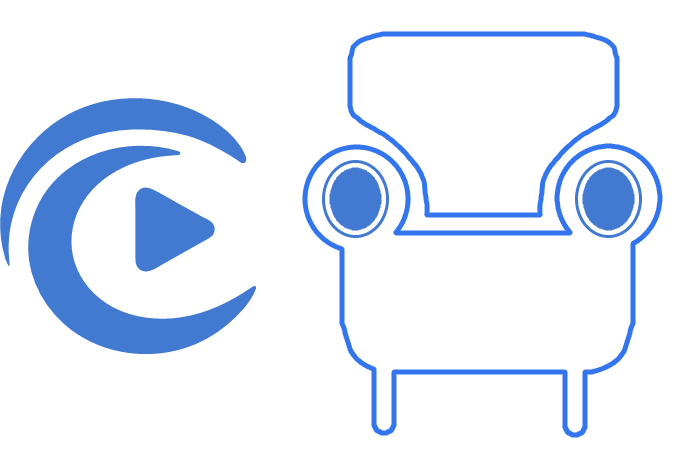

# CoveLounge



CoveLounge is an Android TV client for [Cove](https://github.com/yourcove/cove), built with Jetpack Compose. It provides a remote-friendly (D-pad) interface for browsing and playing media from a Cove server.

## Features

- Home screen with spotlight, continue watching, and media rows
- Jellyfin-style folder/library views for videos, audio, images, and galleries
- Media detail pages with performers, ratings, and continue-watching
- ExoPlayer playback with seeking, transcode settings, and quality menu
- End-of-media ratings screen
- App PIN lock with forgot-PIN flow verified against Cove
- Image caching and settings
- Performer library and performer detail pages

## Requirements

- Android TV / Android device (API 21+)
- A running [Cove](https://github.com/yourcove/cove) server
- The **CoveLounge QuickPin** plugin (v0.1.8+) installed on the Cove server

  Download the plugin here:  
  https://github.com/binarygeek119/cove-ai-plugins/releases/download/cove-lounge%2Fv0.1.8/com.binarygeek119.cove-lounge-0.1.8.zip

  Install it via Cove → Settings → Extensions → Install from ZIP, then configure the public/internal Cove URLs.

## Building

```bash
./gradlew assembleDebug
```

The APK will be at `app/build/outputs/apk/debug/app-debug.apk`.

## License

MIT

> **Disclaimer:** This project is 100% AI-coded. It is tested and written to be as safe as possible, but has not been reviewed by a human code reviewer. Use at your own risk.

> **Quick Pin relay note:** The CoveLounge QuickPin plugin uses a public relay to pair the app with your Cove server. The relay is open source as well, so you can review it. The relay only routes encrypted pairing payloads and never stores media or credentials. Do not use on untrusted networks if you require full privacy.

## Downloader App Code

Downloader app code: `4045057`
